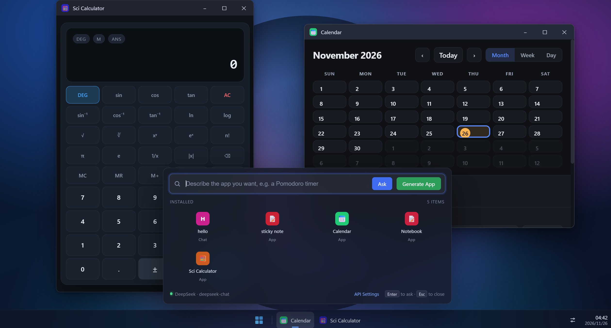
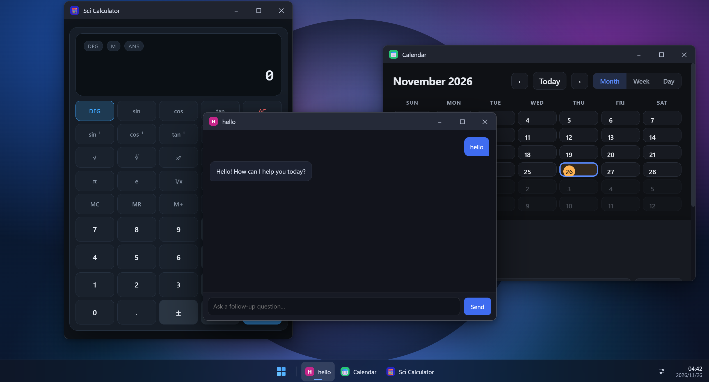

# AI OS

A desktop-style AI workspace that runs in a single HTML file. Describe an app in plain language and the model builds it as a draggable, resizable window on a Windows-like desktop — no build step, no dependencies, no installation.

Everything lives in `index.html`: just open it in a browser and start typing.



## Features

- **Windows-style desktop** — animated wallpaper, centered taskbar, window tabs, tray clock, draggable titles, 8-direction resizing, maximize / minimize / close.
- **Describe → app** — type a request from the Start menu and the AI generates a complete single-file HTML app, rendered in a sandboxed window.
- **Ask mode** — a chat window with multi-turn context, Markdown rendering and syntax-highlighted code blocks; each block can be copied, downloaded, or (for HTML) run directly in a new window.
- **AI thinking** — click the window icon to see a floating, live-updating panel with the prompt, steps, timing and the model's reasoning.
- **38 built-in providers** — OpenAI, Anthropic, Azure OpenAI, Gemini, xAI, DeepSeek, and more — plus Ollama / LM Studio / vLLM and any OpenAI-compatible endpoint.
- **Connection test** — validate endpoint, key and model before generating.
- **Install locally** — generated apps and chats are saved in `localStorage` and appear on the Start menu; right-click to rename, modify with AI, or uninstall. Window size and position are remembered.
- **Themes & wallpaper** — dark / light themes (generated apps follow the active theme), custom wallpaper stored locally.
- **Backup** — export all settings, installed apps, chat history and app data as one JSON file, and restore it later.
- **Offline fallback** — without an API key, a set of built-in templates (todo, calculator, clock, pomodoro, paint, snake, notes) still works.



## Getting started

1. Download `aios.html`.
2. Open it in a Chromium-based browser (Edge, Chrome) — double-clicking works, or serve it locally:

   ```bash
   python -m http.server 8000
   ```

   then visit <http://localhost:8000/aios.html>.

3. Click the Start button, open **API Settings**, pick a provider, paste your API key and save.
4. Type what you want and press **Enter** to chat, or click **Generate** to build an app.

## Usage

| Action | How |
| --- | --- |
| Ask AI | Start menu → type → `Enter` or **Ask** |
| Generate an app | Start menu → type → **Generate** |
| See AI thinking | Click the app icon in the window title bar |
| Reopen an app | Start menu → Installed list |
| Rename / modify / uninstall | Right-click an installed app |
| Theme, wallpaper, backup | System tray (bottom-right) → Settings |

## Privacy

- API keys, installed apps, chats and app data are stored only in your browser's `localStorage`.
- Nothing is sent anywhere except the provider you configure.
- Backups are plain JSON and include your API key in clear text — store them safely.

## Notes

- Opening the file over `file://` may block `localStorage` in some browsers. Use a local HTTP server if data does not persist.
- Some providers do not allow browser (CORS) requests. If a connection test fails, use a proxy or the **Custom (OpenAI-compatible)** entry with your own gateway.
- Generated apps run in a sandboxed iframe; they cannot access the host page's settings.

## Tech

Plain HTML, CSS and vanilla JavaScript in one file. No frameworks, bundlers or external assets.

## Author

LightlyTech — <https://github.com/LightlyTech/AI-OS>

